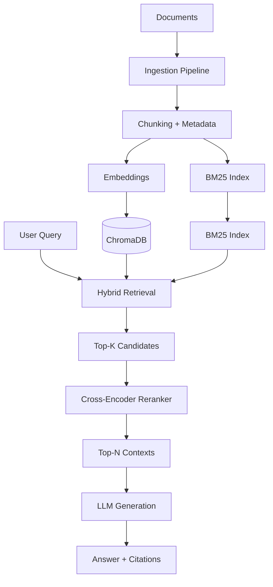
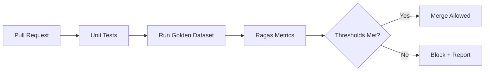

# Ask My Docs

Production-grade Retrieval-Augmented Generation (RAG) system for answering questions against private document collections with high reliability, strict grounding, and measurable quality.

## Project Overview

Ask My Docs is a production-ready RAG application designed to move beyond typical demo-level chat-over-documents implementations. While most RAG prototypes focus on basic retrieval + generation, this system prioritizes **reliability, observability, and regression resistance**.

The core design principles are:

- **Grounded answers only** — responses must be supported by retrieved evidence with explicit citations.
- **Hybrid retrieval** — combines lexical (BM25) and semantic (vector) search to maximize recall.
- **Quality gates in CI/CD** — every change is evaluated against a curated golden dataset before merge.
- **Operational readiness** — structured logging, versioned prompts, and clear failure modes.

The system is built for teams that need trustworthy answers from internal documentation, knowledge bases, or technical manuals rather than best-effort chat responses.

## Technical Architecture

The pipeline follows a classic but hardened RAG flow:

```
Document Ingestion → Hybrid Retrieval → Cross-Encoder Reranking → LLM Generation (with citation enforcement)
```

### High-Level Flow



### Pipeline Stages

1. **Ingestion**
   - Document loading, intelligent chunking, and metadata enrichment.
   - Parallel construction of dense embeddings (stored in ChromaDB) and a sparse BM25 index.
   - Supports incremental updates and document versioning.

2. **Hybrid Retrieval**
   - Concurrent BM25 (lexical) and vector similarity search.
   - Reciprocal Rank Fusion (RRF) or weighted score fusion to produce a candidate set.
   - Tunable candidate pool size (typically 20–50 documents).

3. **Reranking**
   - Cross-encoder model scores query–document pairs for higher precision.
   - Selects the final top-N contexts (usually 4–8) passed to the generator.

4. **LLM Generation**
   - Structured prompt with explicit instructions for citation formatting.
   - Post-generation validation ensures every claim is backed by a retrieved chunk.
   - Configurable temperature, model selection, and fallback behavior.

## Key Engineering Features

### BM25 + Vector Hybrid Search
Pure vector search often misses exact keyword matches (product codes, error strings, names). Pure BM25 misses semantic paraphrases. The hybrid approach runs both retrievers and fuses results, significantly improving recall on real-world document corpora.

### Cross-Encoder Reranking
Bi-encoder retrieval is fast but relatively coarse. A cross-encoder reranker (e.g., `ms-marco-MiniLM` or domain-tuned model) re-scores the candidate set with full attention between query and document, producing higher-precision contexts for the LLM.

### Strict Citation Enforcement
- The generation prompt requires inline citations in a machine-parseable format.
- A post-processing step validates that every factual claim maps to a retrieved chunk ID.
- Answers that fail citation checks are either regenerated or rejected with a clear error.
- Citations are returned to the user as structured references (chunk ID, document name, page/section).

### Additional Production Capabilities
- Deterministic chunking with overlap and metadata preservation.
- Query expansion / rewriting (optional LangGraph node).
- Observability hooks for retrieval latency, reranker scores, token usage, and citation coverage.
- Graceful degradation when no relevant context is found (explicit “I don’t know” responses).

## Evaluation Strategy

Quality is not assumed — it is measured and gated.

### Golden Dataset
- Curated set of **50–200 question–answer pairs** derived from the target document corpus.
- Each pair includes:
  - Question
  - Expected answer (or answer key)
  - Relevant source chunks / documents
  - Difficulty and category tags

### Ragas Evaluation
Every pipeline change is evaluated using [Ragas](https://github.com/explodinggradients/ragas) metrics:

- **Faithfulness** — answer is grounded in the retrieved context
- **Answer Relevancy** — answer addresses the question
- **Context Precision** — retrieved contexts are relevant
- **Context Recall** — all necessary information was retrieved
- **Citation Coverage** — percentage of claims with valid citations

### CI/CD Gated Pipeline


- Thresholds are defined per metric (example: Faithfulness ≥ 0.85, Citation Coverage ≥ 0.95).
- Failures produce a detailed report showing degraded questions.
- Results are stored as artifacts for trend analysis.

## Tech Stack

| Component              | Technology                          | Purpose                                      |
|------------------------|-------------------------------------|----------------------------------------------|
| Orchestration          | LangChain + LangGraph               | Pipeline composition, stateful workflows     |
| Vector Store           | ChromaDB                            | Dense embedding storage and similarity search|
| Sparse Retrieval       | rank-bm25 / custom BM25             | Lexical search                               |
| Reranker               | sentence-transformers (cross-encoder)| Precision re-ranking                         |
| Embeddings             | OpenAI / sentence-transformers      | Document and query embeddings                |
| LLM                    | OpenAI / Anthropic / local          | Answer generation                            |
| Evaluation             | Ragas                               | RAG-specific quality metrics                 |
| Observability          | Structured logging + tracing        | Latency, scores, token usage                 |
| CI/CD                  | GitHub Actions (or equivalent)      | Automated evaluation gates                   |

## Setup Instructions

### Prerequisites
- Python 3.10+
- Docker (optional, for ChromaDB)
- API keys for your chosen LLM and embedding providers

### Installation

```bash
# Clone the repository
git clone https://github.com/your-org/ask-my-docs.git
cd ask-my-docs

# Create virtual environment
python -m venv .venv
source .venv/bin/activate  # Windows: .venv\Scripts\activate

# Install dependencies
pip install -r requirements.txt
```

### Environment Configuration

Copy the example environment file and populate the required values:

```bash
cp .env.example .env
```

Required variables (example):

```bash
OPENAI_API_KEY=sk-...
CHROMA_PERSIST_DIR=./chroma_db
RERANKER_MODEL=cross-encoder/ms-marco-MiniLM-L-6-v2
LLM_MODEL=gpt-4o
GOLDEN_DATASET_PATH=./eval/golden_dataset.json
```

### Running the System

```bash
# Ingest documents
python -m ask_my_docs.ingest --docs-dir ./data/documents

# Start the API / CLI
python -m ask_my_docs.serve
```

### Running Evaluation

```bash
python -m ask_my_docs.eval --golden-set ./eval/golden_dataset.json --output results.json
```

## Best Practices

- **Versioned Prompts**  
  All system and user prompt templates are stored in version-controlled files (e.g., `prompts/v1.2/generation.txt`). Prompt changes are treated as code changes and must pass the golden dataset evaluation.

- **Regression Testing**  
  The golden dataset is the source of truth. Any modification to chunking strategy, embedding model, reranker, fusion method, or prompt must not degrade key Ragas metrics below defined thresholds.

- **Observability**  
  Every retrieval and generation request emits structured logs containing:
  - Query
  - Retrieved chunk IDs and scores (BM25 + vector + reranker)
  - Final context used
  - Citation coverage
  - Latency breakdown
  - Token usage

- **Incremental Indexing**  
  Document updates trigger only the affected chunks to be re-embedded and re-indexed, avoiding full reprocessing.

- **Explicit Failure Modes**  
  When no sufficiently relevant context is found, the system returns a clear “insufficient information” response rather than hallucinating.

## Contributing

1. Create a feature branch.
2. Add or update tests.
3. Ensure the golden dataset evaluation passes CI thresholds.
4. Update prompt versions if prompts were modified.
5. Open a pull request with evaluation results attached.

## License

MIT License — see [LICENSE](LICENSE) for details.
